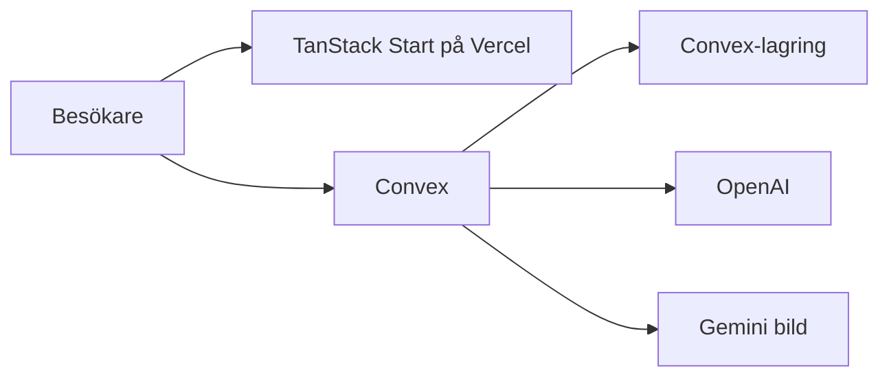

# Teknisk genomgång av Selio

Datum: 12 oktober 2026. Utgångsläge: `master` vid `97d1ebf`. Genomgången beskriver repot som det är. Den ändrar ingen produktkod.

Selio (selio.se) är ett lager- och listningsverktyg för svenska second hand- och kommissionsbutiker. Det som finns i kod är en fungerande kärna: inloggad butik, foto till vara med AI-förslag på titel, text, pris och kategori, studiobild, lagerlista med “markera såld”, och en publik kundbutik på `/butik/$shopSlug`. Det som målbilden beskriver runt inlämnare, prislapp, Swish-utbetalning, Zettle, Fortnox, VMB, Stripe och demobokning finns inte som implementation. Swish och kanalerna Tradera/Meta finns bara som planeringsdokument.

Insatsen nedan är storlek på ändringen, inte kalendertid.

| Storlek | Betydelse |
| --- | --- |
| Liten | En avgränsad yta. Befintlig datamodell räcker. Ingen extern part. |
| Medel | Ny tabell och ett komplett flöde inuti Selio. |
| Stor | Extern API, certifikat, eller flera system som måste hålla samma lagerstatus. |

## Stack och arkitektur

Frontend och SSR körs som TanStack Start (React 19) via Vite 7 och Nitro. På Vercel väljs Nitro-preset `vercel` när `VERCEL=1`, annars `node` så att `npm start` kan köra `.output/server/index.mjs`. Stil är Tailwind CSS 4. shadcn är förberett i `components.json` (alias `~/components/ui`) men inga shadcn-primitiver ligger i repot. Gränssnittet är eget Tailwind mot varumärket i `DESIGNGUIDELINES.md`. `radix-ui` och `class-variance-authority` finns som beroenden.

Backend är Convex 1.35: dokumentdatabas, queries/mutations/actions, fillagring och en daglig cron. AI-anrop sker i Convex-actions med `"use node"` (`openai` och `jimp`). Webbläsaren pratar med Convex direkt via `ConvexAuthProvider` och `@convex-dev/react-query`. TanStack Start äger routing och SSR. Den proxar inte produkt-API:t.

Primära vägar som matchar `AGENTS.md`:

| Väg | Roll |
| --- | --- |
| `/` | Landningssida |
| `/login` | Konto och butiksval |
| `/app` och `/app/varor` | Samma lagerlista |
| `/app/varor/ny` | Foto till vara |
| `/app/varor/$productId/redigera` | Redigering och AI-berikning |
| `/app/butik/design` | Tema, kontakt, logotyp |
| `/butik/$shopSlug` | Publik lista |
| `/butik/$shopSlug/vara/$productId` | Publik vara |

`/demoshop`, `/demoshop/ny` och `/demoshop/snabb` är omdirigeringar till kundbutiken respektive ny vara. `/anotherPage` är en Convex-mall som i produktion bara visar “sidan hittades inte”. Funktionerna den anropar är ändå publika, se säkerhet.

Det finns inga Convex-komponenter (`convex.config.ts` saknas). All domänlogik ligger i appens egna `convex/`-filer. Det är rätt för den här kärnan. Betalningar, utbetalningar och bokföring bör senare kapslas så att certifikat och webhookar inte blandas med lagret.

## Datamodell

Schema: `convex/schema.ts`. Auth-tabellerna kommer från `@convex-dev/auth` (`...authTables`): användare, konton, sessioner och verifikation. Därutöver finns fyra egentliga tabeller plus en malltabell.

**`shops`.** Namn, unik `slug` (`by_slug`), visningsnamn, kontaktfält, fyra hex-färger och `logoStorageId`. Ingen adress, organisationsnummer, Swish-nummer, Zettle-koppling, Fortnox-token eller Stripe-kund.

**`shopMemberships`.** `userId` + `shopId`, index på användare, butik och paret. Ingen roll, ingen inbjudan, ingen `deletedAt`.

**`taxonomyNodes`.** Butikens kategoriträd. `parentId` är `null` för roten. Index `by_shop` och `by_shop_and_parent`. AI får skapa löv under körning.

**`products`.** En bild per vara (`imageStorageId`) plus frivillig källbild (`sourceImageStorageId`). Titel, beskrivning, `priceSek`, butik, kategori, attribut, fritext `userContext`, AI-status (`captureStatus`, `captureListingReady`, `captureStudioImagePending`, `userContextEpoch`), `soldAt` / `soldPriceSek` och mjuk borttagning `deletedAt`. Index: `by_shop`, `by_category_node`, `by_deleted`.

Det som saknas för målbilden sitter i den här tabellen:

- Ingen inlämnare, andel eller utbetalningsstatus.
- Inget inköpspris. VMB går inte att räkna. Designriktlinjen `(pris ut − pris in) × 0,20` har ingen `pris in`.
- Inget kort artikelnummer för prislapp. Convex-id är internt.
- En bild, inte ett galleri.
- `shopId` och `categoryId` är valfria kvarlevor. Nya fotovaror saknar kategori tills AI skrivit den.
- Sålda och borttagna rader ligger i samma `by_shop`-index. Listor filtrerar i minnet.
- `category` och `categoryPathCached` är markerade som legacy.

**`numbers`.** Oanvänd malltabell från Convex-starten. Publik skrivning, se säkerhet.

Attribut är en union i `convex/lib/productAttributes.ts`: fasta text- och måttnycklar, skick som enum, samt egna text- och talrader. Äldre `{ label, value }` får ligga kvar tills en migrering skriver om dem.

Borttagning följer projektregeln: `deletedAt` i millisekunder, cron `purge old soft-deleted products` kl. 02:15 UTC, 14 dagar (`shared/retention.ts`), därefter hård radering av rad och lagrade bilder i batchar om 100. Butiker, taxonomi och medlemskap har ingen motsvarande livscykel.

## Huvudflöden

### Ny vara med AI

`src/features/appNyVaraListing.tsx` och `convex/products.ts` (`createProductFromPhotoCapture`) plus `convex/productListingAi.ts`.

1. Inloggad medlem hämtar en uppladdnings-URL (`generateUploadUrl`, kräver medlemskap).
2. Kamera (baksida, sedan framsida, sedan valfri kamera) eller galleri laddar upp filen.
3. Mutationen skapar en vara med titel “Bearbetar…”, pris 0, status `processing`, och schemalägger `internal.productListingAi.runPipeline`.
4. Pipelinen hämtar bilden, rätar JPEG enligt EXIF och kör parallellt:
   - OpenAI `gpt-5.4-mini` för pris (`productPriceAISchema`).
   - Samma modell för titel, beskrivning, kategori och attribut (`productListingBodyAISchema`).
   - Gemini `gemini-3.1-flash-image-preview` för en kvadratisk produktbild på vit bakgrund.
5. Pris skrivs så fort prissvaret finns. Text och kategori skrivs när kroppssvaret finns (`captureListingReady`). Kategori matchas mot butikens träd eller skapas som nytt löv (`resolveCategoryProposal`).
6. Studiobilden kvadreras till 1024 px, granskas av samma OpenAI-modell (godkänn, rotera 90/180, eller gör om en gång) och ersätter visningsbilden. Källfotot behålls. Om Gemini faller bort används det rätade originalet.
7. Fritext under pågående körning ökar `userContextEpoch` och kör om bara text/pris, så ett sent svar inte skriver över en nyare instruktion.
8. Klienten följer varan via `getProductsQuickReview`.

Redigering (`src/routes/app/varor/$productId/redigera.tsx`) kan låsa upp priset innan övrig text är klar, rotera visningsbilden (`productImageRotate.ts`) och berika om från anteckningar (`productEnrichFromNotes.ts`). Priser normaliseras i `shared/listingPrice.ts` till heltal 1–1 000 000, och ett pris som slutar på 9 höjs ett steg.

Det här är den starkaste delen av kodbasen. Den är också dyr per vara: upp till två Gemini-anrop och flera vision-anrop, utan kvot.

### Lager

`/app` och `/app/varor` renderar samma `AdminDashboard` i `src/routes/app/index.tsx`. Listan kommer från `listProductsByShop` (medlemskap krävs) och filtrerar bort `deletedAt` i funktionen. Klienten söker, filtrerar status och sorterar. KPI: antal till salu, sålda, “behöver åtgärd”, och summa av osålda priser.

“Markera som såld” sätter `soldAt` och `soldPriceSek` efter bekräftelse via `useConfirm`. “Gör tillgänglig” nollar fälten. Mjuk borttagning finns. Pris kan ändras i listan. Sålda varor ligger kvar för historik.

Det är en kill-switch mot den egna kundbutiken: publika queries döljer varor med `soldAt`. Den stänger inga externa annonser. Landningssidan säger också att extern kill-switch ligger på roadmap. Realtid är Convex-prenumerationer, inte en egen websocket.

### Publik butik

`/butik/$shopSlug` läser `getStorefrontBrandingBySlug`, `listTaxonomyTreeByShopSlug` och `listProductsForPublicStorefront`. Sök och kategori ligger i URL (`q`, `kategori`). Detaljsidan visar pris, text, attribut och en karusell med visningsbild plus originalfoto när de skiljer sig. Ägarens verktygsrad visas om den inloggade är medlem i just den sluggen. Kontaktuppgifter ligger i sidfoten. Det finns ingen kassa, reservation eller köpknapp.

Sök och kategori filtreras efter att hela butikens varulista hämtats. Kategorifiltret jämför exakt `categoryId`. Ett klick på en föräldrakategori visar bara varor som ligger direkt på den noden, inte på undernoder. AI lägger varor på löv, så filtret upplevs som tomt för grenar som “Kläder”.

## Auth

`@convex-dev/auth` med lösenordsprovider (`convex/auth.ts`). HTTP-router i `convex/http.ts` exponerar bara auth-rutter. `convex/auth.config.ts` sätter JWT-domän till `process.env.CONVEX_SITE_URL`.

Efter skapad användare:

- E-post `demo@selio.local` kopplas till butiken med slug `demo` (skapas vid behov, namn “Exempelbutik”).
- Övriga utan medlemskap får en ny butik. Slug byggs av e-postens lokaldel, med suffix vid krock. Taxonomins rot “Sortiment” skapas.

Lösenordskravet är minst 4 tecken. Ingen e-postverifiering, ingen återställning och ingen inbjudan syns i koden. Varje nytt konto blir en egen butik och kan anropa AI.

Butiksåtkomst i de viktigaste skrivningarna går via `requireShopMembership` (`convex/lib/shopAccess.ts`): inloggad, och en rad i `shopMemberships` för just `shopId`. Det är rätt mönster och används av lager, redigering, taxonomi, uppladdning och butiksdesign.

Klientens butiksväljare ligger i `sessionStorage` (`src/lib/shopSession.tsx`). Den väljer vilken butik anropen skickar. Servern litar inte på namnet, bara på att användaren är medlem. Saknas butik efter inloggning stannar skalet på “Ditt konto saknar butikstilldelning”. Har användaren exakt en butik hoppar inloggningen dit. Flera butiker ger en väljare. `bootstrapViewerShopSession` föredrar demobutiken om användaren är medlem där.

`/app` kräver Convex-auth i klienten och skickar oinloggade till `/login`. Publik butik kräver ingen auth. Skyddet som betyder något är medlemskapet i Convex-funktionerna.

Demolösenordet `demo` ligger i `shared/shopConstants.ts` och importeras av inloggningssidan, alltså i klientbundlen. `?demo=1` loggar in, eller skapar kontot om det saknas. Sidan visar också e-postadressen. Det är en medveten genväg för exempelbutiken. Tillsammans med migreringsmutationerna nedan är den farlig i produktion.

## AI-integration

| Steg | Var | Modell |
| --- | --- | --- |
| Pris från foto | `runPipeline`, `regenerateListingText` | `gpt-5.4-mini`, reasoning `low` |
| Titel, text, kategori, attribut | samma | samma |
| Bild-QA och rotation | `runOpenAiProductImageQa` | samma |
| Studiobild | `runGeminiProductImage` | `gemini-3.1-flash-image-preview` |
| Berika befintlig vara från anteckning | `enrichProductFromNotes` | två parallella OpenAI-anrop |

Nycklar läses bara i actions: `OPENAI_API_KEY` och `GEMINI_API_KEY` i Convex-miljön. De ligger inte i `.env.example`. Gemini-nyckeln skickas som query-parameter på `generativelanguage.googleapis.com`. Svarsscheman är Zod i `shared/productAiSchema.ts` och `shared/productImageQaSchema.ts`, delade mellan action och validering. Attribut mappas till lagringsformat i `normalizeAiAttributes`.

Promptarna för listning och berikning är i praktiken två kopior (systemtexter på svenska, kategoriregler, “inga tveksamma bildformuleringar”). En ändring i ton eller schema behöver göras på båda ställena.

Fel i pipelinen anropar `markCaptureFailed`. Varan får status `error` och döljs i kundbutiken, även när titel och pris redan sparats och bara bilduppladdningen föll. Om studiobilden inte går att bygga alls avslutas varan ändå som `ready` utan ny fil. De två felen hanteras olika.

`regenerateListingText` återvänder tyst om `OPENAI_API_KEY` saknas. Användaren ser ingen ny text och inget fel.

Det finns ingen kvot, ingen kö och ingen kostnadsspärr per butik. Ett konto kan lägga upp varor i en ström. Varje vara kan dra två bildgenereringar och flera vision-anrop.

## Miljö och deploy

`.env.example` dokumenterar bara `VITE_CONVEX_URL`. Kommentaren säger att `CONVEX_SITE_URL` ska vara appens publika origin, till exempel Vercel-adressen. I Convex Auth ska den variabeln vara deploymentens egen site-URL (den som Convex sätter, `*.convex.site`). Att skriva över den med selio.se gör att JWT-valideringen i `auth.config.ts` pekar fel.

Det som en körande miljö faktiskt behöver, och som exempelfilen inte listar:

| Variabel | Var | Roll |
| --- | --- | --- |
| `VITE_CONVEX_URL` | Vercel och lokal Vite | Klientens Convex-adress |
| `OPENAI_API_KEY` | Convex | Text, pris, bild-QA |
| `GEMINI_API_KEY` | Convex | Studiobild |
| `JWT_PRIVATE_KEY` och JWKS | Convex | Sätts av Convex Auth, inte av appen |
| `CONVEX_SITE_URL` | Convex | Sätts av plattformen. Ska inte pekas om till Vercel |

`package.json` kräver Node `>=22.12.0`. Script: `dev` (Convex och Vite tillsammans), `build` (ikoner, Vite, `tsc --noEmit`), `start`, `lint` (`tsc` och ESLint), `deploy:convex` (`npx convex deploy`). Ingen `test`-script.

Deploy är två steg som inte är ihopkopplade i repo: Vercel bygger frontend när `VERCEL=1`, Convex deployas för sig. Ingen `vercel.json`, inga GitHub Actions, ingen förhandsvisningsmiljö beskriven. README täcker lokal körning och nämner inte AI-nycklarna.

## Testtäckning

Det finns inga tester. Inga `*.test.ts` / `*.spec.ts`, ingen Vitest, Playwright eller `convex-test`, och inget CI som kör `lint` eller `build`.

Det som är mest värt att låsa först, när tester införs:

- Prisnormalisering i `shared/listingPrice.ts` (ren funktion).
- Attributmappning i `normalizeAiAttributes`.
- Publik synlighet: såld, borttagen, `processing` och `error` ska inte synas.
- Medlemskap: en annan butiks id ska avvisas.
- Kategorifilter ska inkludera undernoder.
- Epoch: ett sent AI-svar ska inte skriva över en nyare `userContext`.

AI-anropen bör mockas. De hör inte hemma i ett enhetstest mot riktiga nycklar.

## Kodkvalitet

Det som håller:

- TypeScript `strict`, `noUnusedLocals`, `noUnusedParameters`.
- UI på svenska, “vara/varor”, bekräftelser via `useConfirm` med terracotta för destruktivt.
- Butiksskrivningar samlade bakom `requireShopMembership`.
- Argumentvalidering finns på de publika Convex-funktionerna som granskats.
- Mjuk borttagning och cron följer projektregeln.
- AI-svar tolkas med Zod innan de skrivs.
- Epoch-skydd mot tävlande textgenereringar.

Det som tynger:

- Få funktioner har `returns`. Bara pris, såld-status och två interna AI-patchar i `products.ts` deklarerar returtyp. ESLint-pluginet `@convex-dev/eslint-plugin` är inkopplat, men inget CI kör det.
- Listor använder `.collect()` på butikens alla varor och, i två mutationer, på hela `products`. Ingen paginering.
- `as never` vid `replace`/`patch` i butiksdesign och taxonomimigrering. `updateStorefrontBranding` gör `replace` av hela butiksdokumentet. Ett nytt fält på `shops` som glöms i den funktionen nollställs vid sparad design.
- `src/router.tsx` kastar `(import.meta as any).env`.
- AI-prompter och kategorilogik är duplicerade mellan `productListingAi.ts` och `productEnrichFromNotes.ts`.
- Stora filer utan skarvar: `productListingAi.ts`, `taxonomy.ts`, `products.ts`, redigeringssidan, lagerlistan, landningssidan, ny-vara-flödet.
- Mallrester: `convex/myFunctions.ts`, tabellen `numbers`, `convex/README.md` (Convex standardtext), `/anotherPage`.
- Agent-skills för bildgenerering är kopierade under många kataloger (`.claude`, `.agents`, `.cursor` med flera). De är inte produktkod, men de dominerar filträdet.
- shadcn är konfigurerat och oanvänt. Nya ytor kan följa `AGENTS.md` och lägga primitiver när de byggs. Befintliga sidor behöver inte migreras för sakens skull.

## Säkerhetsrisker

Ordnade efter vad en inloggad, eller oinloggad, anropare kan göra mot produktionsdata.

1. **`ensureDemoEnvironment` skriver över alla varor.** `convex/taxonomy.ts`. Kräver bara att någon är inloggad. Den läser hela `products` och kan sätta `shopId` till demobutiken när fältet saknas, och sätta `categoryId` till en nod i demobutikens träd även när varan tillhör en annan butik. Inloggningen anropar den vid varje lyckad session (`src/routes/login.tsx`). En vara som fastnat utan kategori (till exempel efter AI-fel) kan alltså få en kategori från fel butik, och senare underkännas av `assertCategoryBelongsToShop`.

2. **`ensureDemoShopAndBackfill` gör samma heltabellssvep.** `convex/shops.ts`. Anropas inte från klienten nu, men är en publik mutation med samma “inloggad räcker”-spärr och tilldelar varor utan `shopId` till demobutiken.

3. **`listProducts` läcker alla butikers varor.** `convex/products.ts`. Vilken inloggad användare som helst får alla aktiva varor, inklusive fritext, priser, sålt pris och bild-URL:er. Klienten använder `listProductsByShop`. Queryn är ändå ett publikt API.

4. **Publika varuqueries returnerar hela dokumentet.** `enrichProductDoc` sprider `...doc`. Kundbutiken får därmed `userContext` (personalens fritext), `captureError` och interna flaggor i svaret, även om sidan bara ritar titel, pris, text, attribut och bilder. Originalfotot i karusellen är avsiktligt. Fritexten är det inte.

5. **Demokontot är publikt.** E-post och lösenord `demo` ligger i klientkoden. Kontot kan skapas av vem som helst via `?demo=1`. Kontot har i sig bara demobutiken, men punkt 1 gör att varje inloggning, inklusive demo, kan röra andras varor.

6. **Mallfunktioner utan auth.** `myFunctions.listNumbers`, `addNumber` och `myAction` är publika. UI:t är dolt utanför `import.meta.env.DEV`. Funktionerna deployas ändå. Vem som helst kan skriva i `numbers`.

7. **Öppen registrering utan spärr mot AI-kostnad.** Nytt konto skapar butik direkt. Lösenord kan vara fyra tecken. Ingen verifiering, så en registrering kan lägga beslag på en e-postadress som ägaren inte kontrollerar. Därefter finns ingen gräns för OpenAI- och Gemini-anrop.

8. **Felstack visas för besökare.** `defaultErrorComponent` i `src/router.tsx` renderar `err.error.stack`.

9. **Uppladdning saknar typ- och storlekstak** innan bilden skickas till modeller. Uppladdnings-URL:en kräver medlemskap för att utfärdas, vilket är rätt, men en medlem kan mata pipelinen med stora filer.

Butiksdesign, redigering, uppladdning, taxonomiändring, mjuk borttagning och “såld” kontrollerar medlemskap. Publik läsning av en butiks synliga sortiment är avsiktlig. Convex-id:n för lagring är svåra att gissa. Inget tyder på att hemligheter ligger i git; risken är öppen API-yta och saknad kvot.

## Buggar och teknisk skuld

| Fynd | Varför det spelar roll |
| --- | --- |
| Kategorifilter är exakt nod, inte undernoder | Grenar i kundbutiken ser tomma ut |
| Bilduppladdningsfel efter lyckad text sätter `captureStatus: "error"` | Färdig listning döljs i kundbutiken |
| `ensureDemoEnvironment` på varje inloggning | Heltabellssvep och fel butiks taxonomi, se säkerhet |
| `userContext` i publikt svar | Personalanteckningar lämnar verktyget |
| Gemini-nyckel i querysträng | Kan hamna i loggar hos mellanliggande lager |
| Tyst avbrott när nyckel saknas i `regenerateListingText` | Användaren tror att berikningen inte tog |
| `replace` av hela `shops`-dokumentet | Nya butiksfält riskerar att raderas vid design-sparning |
| Inget artikelnummer, inköpspris, inlämnare | Blockerar prislapp, VMB och utbetalning |
| Lager och kundbutik hämtar alla varor | Håller för en pilotbutik, inte för ett stort lager |
| Ingen testkörning i CI | Regressions på pris, synlighet och medlemskap upptäcks manuellt |
| Planeringsdokument för Swish beskriver fel produkt | `swish-docs/` är Commerce (kund betalar butiken). Målbilden är utbetalning till inlämnare |
| Tradera och Meta | Katalogerna `tradera/` och `meta-marketplace/` är avsedda flöden, inte kod. De står utanför den smala målbilden och bör inte gå före den |

Kill-switchen i appen fungerar för `/butik`. “Såld” är lokalt tillstånd. Externa kanaler finns inte att stänga.

## Målbild mot kod

Målbilden är ett smalt flöde: inlämnare registreras, foto blir vara med AI-titel och prisförslag, prislapp skrivs ut, försäljning betalas ut till inlämnaren via Swish, lager går till kassa (Zettle) och bokföring (Fortnox), VMB-rapport, prissida med Stripe, och en landningssida där man bokar demo.

| Del | Status | Vad som finns | Insats | Vad som måste till |
| --- | --- | --- | --- | --- |
| Inlämnarregistrering | Saknas | Butikskonto skapas vid signup. Ingen inlämnare, inget avtal, inget Swish-nummer, ingen provisionsandel | Medel | Tabell `consignors` med mjuk borttagning, medlemskapsspärr, formulär i verktyget. Bank- och personuppgifter behöver ett medvetet fälturval |
| Foto till vara, AI-titel och pris | Finns | Kamera/galleri, parallellt pris och text, kategori, attribut, studiobild, granskning, berikning | Liten att koppla på | Flödet är byggt. Kvar är att sätta inlämnare och inköpspris/andel på varan när de fälten finns. Kvot och felstatus är hårdning, inte nya funktioner |
| Prislapp | Saknas | Pris och titel finns. Inget utskriftsläge, ingen QR, inget kort nummer | Liten | Utskriftsvy med butiksnamn, titel, pris, kort kod. QR kan peka på publik vara eller intern redigering |
| Swish-utbetalning till inlämnare | Saknas | `swish-docs/` beskriver inkommande Commerce-betalning och mTLS, inte utbetalning. Ingen `convex/swish.ts`, ingen reskontra | Stor | Först en reskontra (skuld per inlämnare och vara). Sedan Swish Utbetalningar, certifikat, webhook, status. Bygg inte Commerce-flödet och kalla det utbetalning |
| Export till kassa (Zettle) | Saknas | “Såld” är bara ett fält. Ingen OAuth, ingen artikel i kassan, ingen kvittohook | Stor | Butikskoppling, artikel med stabilt id, skicka pris/titel, ta emot försäljning och sätt `soldAt` en gång. Samma väg behöver Fortnox se |
| Export till bokföring (Fortnox) | Saknas | Ingen OAuth, ingen verifikation, inget konto | Stor | OAuth per butik, mappning av VMB-moms mot rätt konton, verifikation per försäljning eller per period. Beror på att inpris och utpris finns |
| VMB-rapport | Saknas | Bara utpris och eventuellt sålt pris. Formeln står i `DESIGNGUIDELINES.md` och används inte | Medel | Inköpspris på varan. Rapport över period: ut, in, marginal, moms `marginal × 0,20` när marginalen är positiv, annars 0. CSV räcker före Fortnox |
| Prissida och Stripe-abonnemang | Saknas | Ingen `/priser`, inget Stripe-paket, ingen plan på butiken | Medel | Produkter i Stripe, Checkout eller Customer Portal, webhook som sätter plan på `shops`, och en grind på AI-anrop. Kan vänta tills piloten ska betala |
| Landningssida med demobokning | Delvis | `/` är en svensk landningssida med exempelbutik och `mailto:kontakt@selio.se`. Texten säger att intresseformulär kommer senare. Ingen kalender, inget formulär, ingen sparad lead | Liten | Formulär som sparas i Convex, eller en inbäddad kalender. E-postlänken kan stå kvar |

VMB och Swish-utbetalning pekar åt olika avtal om man inte bestämmer datan. VMB behöver ett inköpspris (butiken har köpt varan av en privatperson). Utbetalning till inlämnare behöver en andel eller ett belopp som butiken är skyldig efter försäljning. I kommission är inköpspriset ofta just det som betalas ut. Fälten bör därför vara explicita: inpris eller överenskommen utbetalning, provisionsandel, status obetald/betald. Den här genomgången tar inte ställning till vilket skatterättsligt upplägg en butik ska använda.

## Föreslagen ordning

1. **Lås butiksgränsen.** Innan pengar, personuppgifter eller fler butiker. Annars kan en inloggning skriva kategori på någon annans vara.
2. **Inlämnare och ekonomifält på varan.** Allt annat i det smala flödet läser de fälten.
3. **Koppla fotoflödet till inlämnaren.** AI-listningen finns. Den ska välja inlämnare och kunna bära inpris eller andel.
4. **Prislapp.** Syns i butiken samma dag som varan läggs upp, och behöver inget externt avtal.
5. **VMB-rapport som CSV.** Använder fälten från steg 2. Fortnox kan komma senare och ta samma siffror.
6. **Demobokning på landningssidan.** Oberoende av lagret. Kan göras parallellt med steg 2–4 om sälj behöver den först.
7. **Stripe.** När en pilot ska betala, och när AI-anrop ska kunna stängas av utan plan.
8. **Zettle.** Först när “såld i kassan” ska sätta samma `soldAt` som knappen i verktyget. Kräver stabilt artikel-id från prislappen.
9. **Fortnox.** När VMB-raden är granskad av en riktig butik. Verifikationen ska inte hitta på inpris.
10. **Swish-utbetalning.** Sist av integrationerna. Kräver reskontra, certifikat och ett avtal som matchar utbetalning, inte kundbetalning. Nuvarande `swish-docs/` behöver skrivas om innan någon bygger den.

Tradera och Meta står kvar som kanaler efter att Zettle-synken finns. Samma “en vara, en försäljning”-regel, men de är inte med i det smala flödet.

## Nästa fem uppgifter

### 1. Lås tenant-gränsen och ta bort mall-API:t

Gör `ensureDemoEnvironment` och `ensureDemoShopAndBackfill` till interna engångsjobb, eller ta bort anropet från `src/routes/login.tsx` och spärra dem så att de bara rör demobutikens egna rader. Ta bort eller auth-spärra `listProducts` så att en inloggad användare bara ser butiker hen är medlem i. Låt publika varuqueries returnera ett smalt objekt utan `userContext`, `captureError` och epoch-fält. Ta bort `convex/myFunctions.ts` från den publika ytan och tabellen `numbers` när inget anropar den. Flytta demolösenordet ur klientbundlen. Kategorifiltret i `listProductsForPublicStorefront` bör i samma svep inkludera undernoder.

Klart när: ett konto i butik A inte kan läsa butik B:s varor, en inloggning inte skriver om andras `categoryId`, och kundbutikens nätverkssvar saknar personalens fritext.

### 2. Datamodell för inlämnare och varans ekonomi

Ny tabell för inlämnare, knuten till `shopId`, med namn, kontakt, valfritt Swish-nummer och mjuk borttagning. På `products`: inlämnare, inpris eller överenskommet utbetalningsbelopp, provisionsandel, kort artikelkod, och utbetalningsstatus. Index för inlämnare och för butik plus status. Queries och mutationer med `requireShopMembership`, argument- och returvalidering. Ingen publik läsning av Swish-nummer.

Klart när: en vara kan sparas med inlämnare och inpris, och en annan butik inte kan läsa raden.

### 3. Registrera inlämnare och välj den i Ny vara

Svensk vy i verktyget för att lägga till och arkivera inlämnare. I fotoflödet och på redigeringssidan: välj inlämnare innan eller direkt efter att bilden sparas. AI-titel och prisförslag rörs inte. Tomt läge ska säga till att inlämnaren saknas, utan att blockera ren butikslager-användning om en vara medvetet saknar inlämnare.

Klart när: en ny vara från kamera kan öppnas i redigering med rätt inlämnare och ett ifyllt prisförslag.

### 4. Prislapp

Utskriftsvy från varan: butikens visningsnamn, titel, pris i kronor, kort artikelkod, och en QR eller URL till den publika varan. Webbläsarens utskrift räcker. Ingen ny tjänst. Koden ska vara läsbar i monospace enligt designriktlinjen.

Klart när: en vara kan skrivas ut som en lapp som en expedit kan sätta på plagget, och koden går att koppla tillbaka till samma vara.

### 5. VMB-underlag för en period

Vy i verktyget över sålda varor i ett datumintervall. Per rad: artikelkod, titel, utpris, inpris, marginal, moms på marginalen när marginalen är positiv. Rader utan inpris markeras som ofullständiga och ingår inte i summan. Export som CSV. Formeln samlas i en ren funktion som går att testa utan Convex.

Klart när: en butik med tre sålda varor, varav en saknar inpris, ser två rader i summan och en ofullständig rad, och CSV:n matchar vyn.

Demobokning på `/` är den bästa sidouppgiften om sälj behöver den under tiden. Den delar inte datamodell med uppgift 2–5: ett formulär eller en kalenderinbäddning, sparad lead, och den befintliga e-postadressen kvar.
